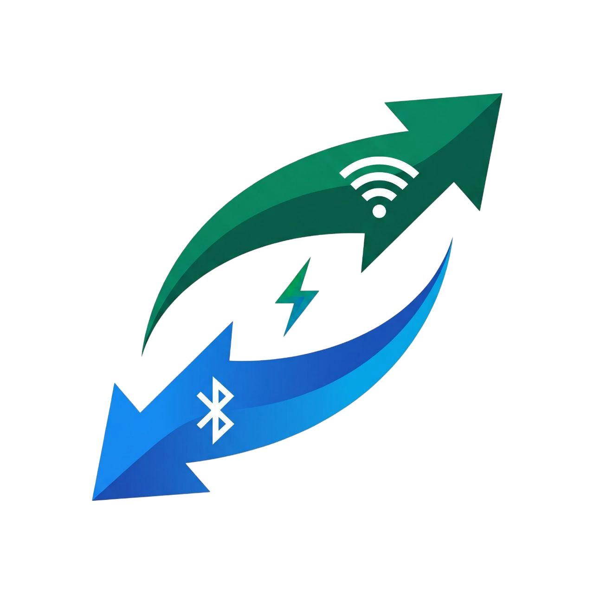

# NextToMe
### Next-Gen High-Speed, Zero-Copy P2P File Sharing Application

<div align="center">
  
  <p><strong>Direct Offline Sharing • 40MB/s+ Speeds • Cross-Platform Mobile & PC Web</strong></p>
</div>

---

## Key Features

* **Hybrid Fast Connectivity**:
  * **BLE Auto-Discovery (1-2s)**: Instant nearby beacon discovery without manual pairing.
  * **Invisible Handshake**: Automatic cryptographic credential exchange (`DIRECT-NM-xxxx`).
  * **5GHz Wi-Fi Direct High-Speed Transfer**: Direct socket channel reaching **40MB/s+** transfer speeds.
* **Retro Backward Compatibility**:
  * Compatible from **Android 5.0 (API 21 / Lollipop)** and **iOS 12** onwards.
  * Automatic graceful fallback to **2.4GHz Wi-Fi**, **Legacy Hotspot with QR Code pairing**, and **Bluetooth Classic (RFCOMM)**.
* **Phone-to-PC (Zero Software Needed)**:
  * Integrated local HTTP server with responsive Web UI.
  * Connect any PC browser via IP address or QR code to upload or download files via drag-and-drop.
* **Stream While Downloading**:
  * Progressive media streaming enabled as soon as the first **5%** is received.
* **Offline Wi-Fi Chat (WhatsApp-Style)**:
  * Full real-time messaging, links, and text sharing over Wi-Fi Direct/LAN without internet access.
* **Universal Clipboard**:
  * Real-time cross-device clipboard synchronization between phones and PCs.
* **Smart Storage & Security**:
  * Storage pre-validation to prevent low-disk freezes.
  * Optional 4-digit PIN authentication for untrusted environments.
* **Host Speed & Data Limits**:
  * Set individual speed throttling (e.g. 5 MB/s) and byte quotas (e.g. 1 GB) per peer.
* **Green Code & Eco Mode**:
  * Zero-Copy kernel streaming architecture (`sendfile()` / C++ NDK) saving battery and CPU.

---

## Project Structure

```text
lib/
├── core/
│   ├── constants/             # Network ports (52520, 8080), OpCodes, buffer sizes
│   ├── models/                # DevicePeer, TransferTask, SpeedLimitProfile
│   └── theme/                 # Cyber-neon OLED Dark theme (Electric Cyan & Neon Green)
├── services/
│   ├── connection/            # BLE Discovery, Handshake Protocol, Wi-Fi Direct, LAN mDNS
│   └── transfer/              # Chunk streaming, SpeedThrottler, Storage validation
└── ui/
    ├── screens/               # Radar scan screen, Transfers, Settings
    └── widgets/               # Radar scanner, Peer cards, Transfer cards, Limits dialog
```

---

## Getting Started

### Prerequisites
* Flutter SDK (3.13+)
* Android Studio / VS Code
* Android SDK (API 21 to 34)

### Installation
```bash
# Clone the repository
git clone https://github.com/DaxAPro/Next-to-me-file-transfer.git

# Enter project directory
cd Next-to-me-file-transfer

# Get Flutter dependencies
flutter pub get

# Run on connected device or emulator
flutter run
```

---

## License
This project is licensed under the MIT License.
