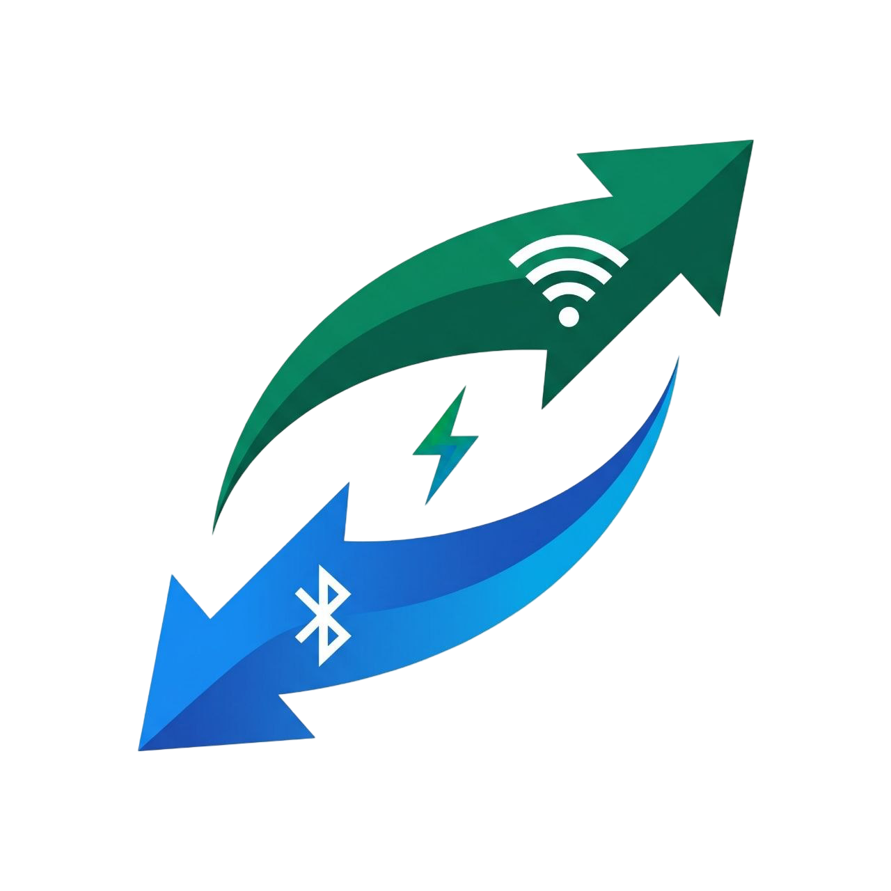

# NextToMe
### Local peer-to-peer file sharing and communication

<div align="center">
  
  <p><strong>Direct local transfers • Offline group chat • PC browser portal</strong></p>
</div>

---

## Key Features

* **Nearby discovery and local transfers** over BLE and local Wi-Fi connections.
* **Android local-only hotspot** with in-app network name and password controls.
* **PC web portal** on port `8080`, with QR access, mDNS name `nexttome.local`,
  multipart uploads, downloads, file deletion, and WebSocket group chat.
* **Offline group chat** with local SQLite history and an active-members view.
* **Local profile and theme preferences**, including a persistent display name and
  optional dark mode.
* **Global internet speed test** for download, upload, and HTTPS round-trip
  latency. This optional feature requires the internet and sends generated test
  data to Cloudflare; it does not send shared files or chat messages.

---

## Project Structure

```text
lib/
├── core/
│   ├── constants/             # Network ports (52520, 8080), OpCodes, buffer sizes
│   ├── models/                # DevicePeer, TransferTask, SpeedLimitProfile
│   └── theme/                 # Emerald Green, Electric Cyan, light and dark themes
├── services/
│   ├── connection/            # BLE, local sockets, hotspot, mDNS, portal and speed test
│   └── storage/               # SQLite local chat history
└── ui/
    ├── screens/               # Radar, chat, web portal, speed test, profile and legal screens
    └── widgets/               # Radar scanner, Peer cards, Transfer cards, Limits dialog
```

---

## Getting Started

### Prerequisites
* Flutter SDK (3.13+)
* Android Studio / VS Code
* Android SDK with Android 12+ nearby-device permissions available

### Installation
```bash
# Clone the repository
git clone https://github.com/DaxAPro/Next-to-me-file-transfer.git

# Enter project directory
cd Next-to-me-file-transfer

# Get Flutter dependencies
flutter pub get

# Run on connected device or emulator
flutter run
```

### Local web portal

1. Connect the phone and computer to the same Wi-Fi network, or start the
   Android local-only hotspot from **Settings** and connect the computer to it.
2. Open **PC Web Portal** from the navigation drawer and start the portal.
3. Scan its QR code or open the displayed link. The link includes a private
   session token; share it only with people you trust.

Uploads are stored in the app's private local support directory and can be
removed from the portal. mDNS advertises the local HTTP service; the screen
provides an IP-based link when mDNS is unavailable.

---

## License
This project is licensed under the MIT License.
